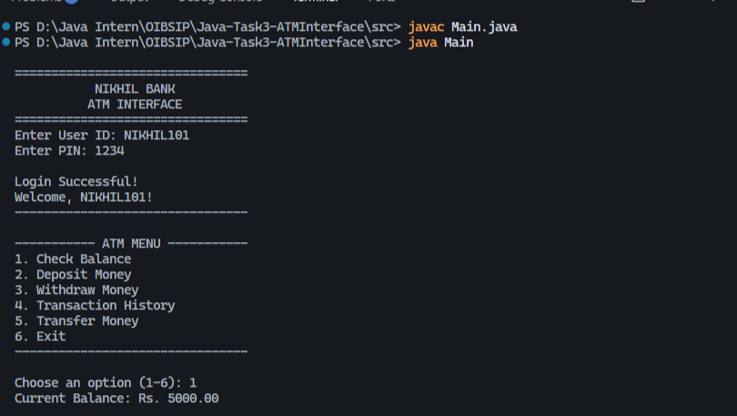
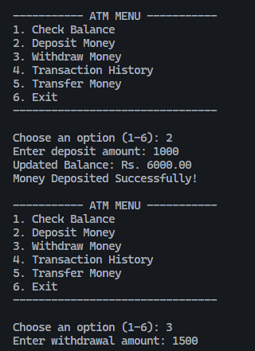
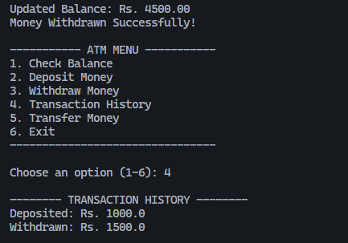
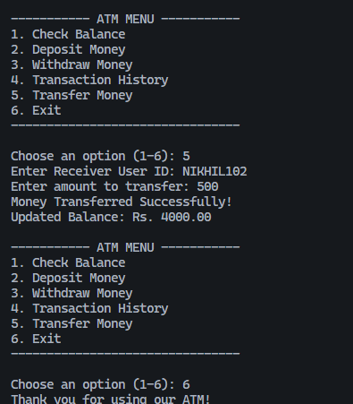
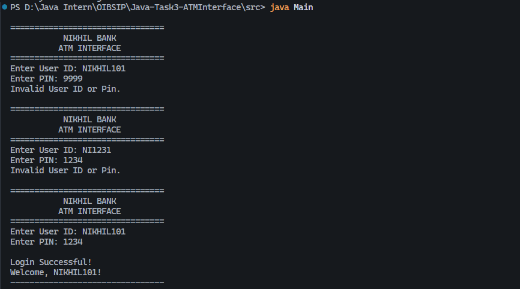
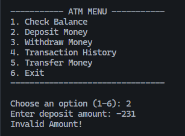
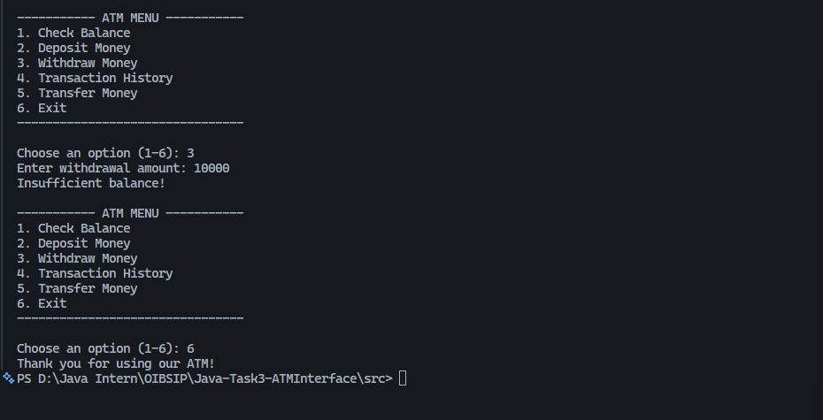

# ATM Interface (Java)

This is my Java console-based ATM Interface project for **Task 3** of the Oasis Infobyte Java Development Internship.

The application allows users to log in using their User ID and PIN and perform basic banking operations.

## Features

- User login with User ID and PIN.
- Maximum 3 incorrect login attempts.
- Check account balance.
- Deposit money with amount validation.
- Withdraw money with sufficient balance validation.
- Transfer money between accounts.
- Transaction history using `ArrayList`.
- Separate transaction records for sender and receiver.
- Account validation and self-transfer prevention.
- Exit option with a goodbye message.

## Built With

- Java
- Object-Oriented Programming (OOP)
- ArrayList
- Scanner

## Project Structure

```text
Java-Task3-ATMInterface/
├── src/
│   ├── Main.java
│   ├── ATM.java
│   ├── Account.java
│   ├── Bank.java
│   └── Transaction.java
├── screenshots/
└── README.md
```

## How to Run

Make sure Java JDK is installed.

Open a terminal inside the `src` folder and run:

```bash
javac *.java
java Main
```

## Screenshots

### 1. Login and Balance Check



### 2. Deposit and Withdrawal



### 3. Transaction History



### 4. Money Transfer and Exit



### 5. Invalid User ID or PIN



### 6. Invalid Amount



### 7. Insufficient Balance



## Note

This project stores account balances and transaction history in memory. Data resets when the application is restarted.

---

**Internship:** Oasis Infobyte – Java Development  
**Task:** Task 3 – ATM Interface  
**Developer:** Nikhil Parmar.