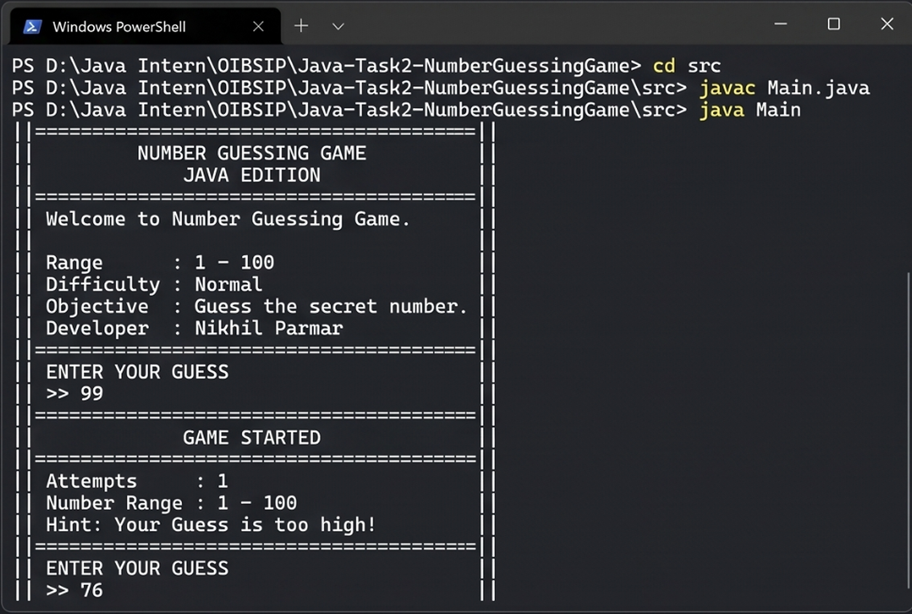
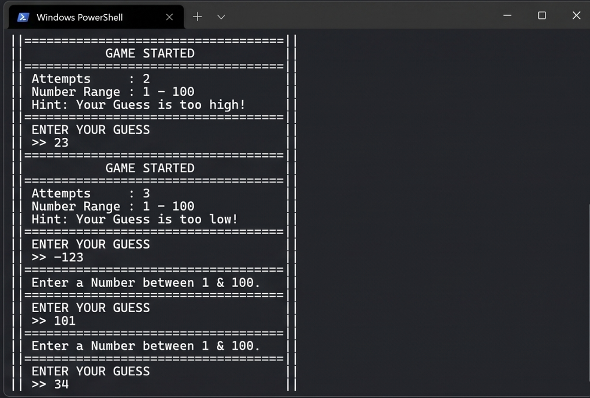
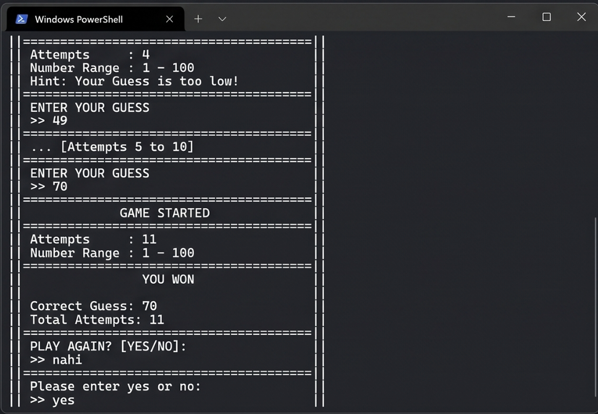
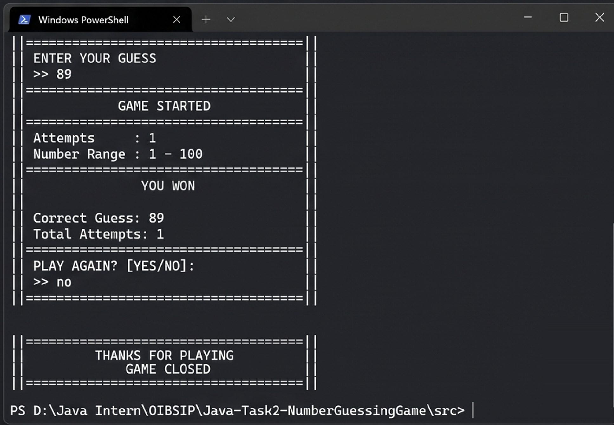

# Number Guessing Game – Java

A simple console-based Number Guessing Game built using Java as part of my Oasis Infobyte Java Development Internship (Task 2).

The game generates a random number between 1 and 100, and the player has to guess it. After every guess, the game gives a hint to help the player find the correct number.

## Features

- Random number generation between 1 and 100.
- Hints for guesses that are too high or too low.
- Input validation for numbers outside the given range.
- Handles invalid non-numeric input.
- Tracks the total number of attempts.
- Option to play multiple rounds.
- Replay input validation.

## Technologies Used

- Java
- Java Random Class
- Java Scanner Class
- Object-Oriented Programming

## Project Structure

```text
Java-Task2-NumberGuessingGame/
│
├── src/
│   ├── Main.java
│   ├── GameManager.java
│   └── GameInput.java
│
├── screenshots/
│   ├── 01_Game_Start_Intro.png
│   ├── 02_Gameplay_Validation.png
│   ├── 03_Late_Gameplay_Win.png
│   └── 04_Replay_Exit.png
│
└── README.md
```

## How to Run

Make sure Java JDK is installed on your system.

1. Clone this repository:

```bash
git clone https://github.com/nikhil-r-parmar/OIBSIP.git
```

2. Open the project folder:

```bash
cd Java-Task2-NumberGuessingGame
```

3. Go to the source folder:

```bash
cd src
```

4. Compile the program:

```bash
javac Main.java
```

5. Run the game:

```bash
java Main
```

## Screenshots

### 1. Game Start & Introduction



### 2. Gameplay & Input Validation



### 3. Late Gameplay & Winning



### 4. Replay & Exit



## What I Practiced

While building this project, I practiced:

- Organizing a Java program into multiple classes.
- Using loops and conditional statements.
- Generating random numbers.
- Taking user input using Scanner.
- Handling invalid input with exception handling.
- Managing game attempts and replay logic.

## Author

**Nikhil Parmar**

BCA Student | Aspiring Software Engineer

---

*Built as part of the Oasis Infobyte Java Development Internship – Task 2.*